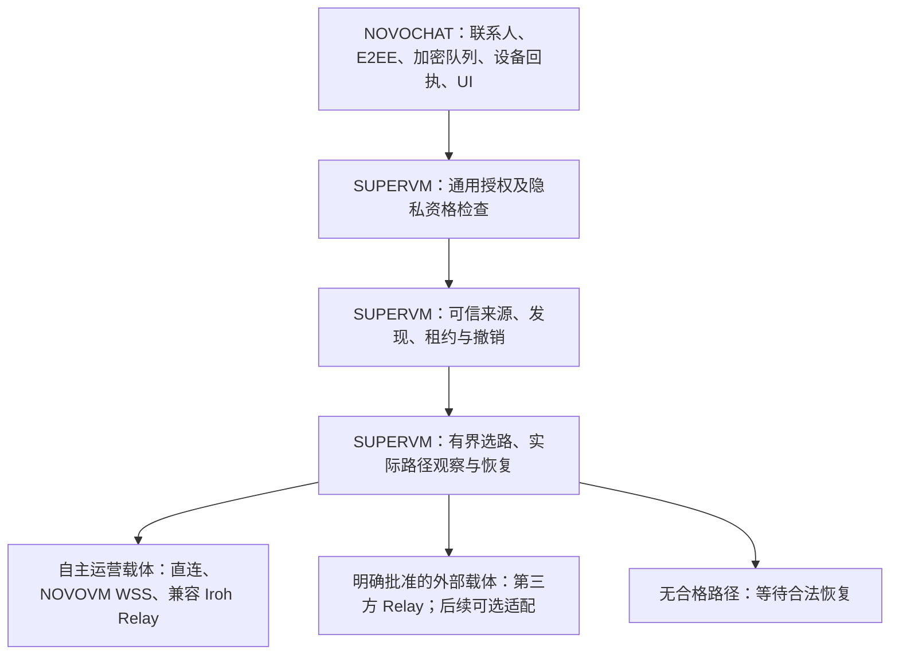

# NOVONET 多路径自主通讯架构与传输策略 v1

日期：2026-10-12。状态：本轮采纳的架构原则与分阶段实施方案，**不是全能力已交付声明**。
本文定义 SUPERVM 的通用网络方向；NOVOCHAT 是首个手机产品验证场景。
不改变原 `novovm-node` 产品总控、AOEM 执行语义、金融账本或共识。

核对基线：SUPERVM `6f05f98f49961623a3f76724ac172cac146a35b2`，
NOVOCHAT `9f0f7f38cb956b9d5f131b855bfa9dee4d524e3d`；核对时两仓
本地/远端 main 一致、工作区干净。通用网络实现输入为 `51d50bf2`。
本轮仅阅读源码、既有实测记录和官方资料并形成设计；不新增构建、手机测试或部署。
当前验收依据见[生产台账](NOVOVM_PRODUCTION_READINESS_TRACKER.md)。

## 2026-10-13 最新修订：自主入网与统一账户

商业模式随后明确为 NOVOCHAT 试用 1–3 个月、之后 NOV 标价且只收 NOV，
USD 对照。月订阅覆盖创始人至少 5 USD 等值分账、奖励与服务成本，具体
估值时点/价格风险由经济契约定义；网络参与权不等于服务免费。订阅及奖励属于
[经济规则](NOVOVM-ECONOMICS/NOVONET-CONTRIBUTION-REWARDS-DRAFT-2026-10-13.md)，
已有有效额度不逐消息等链上结算，不引入唯一官方订阅认证服务器。

用户进一步明确：网络参与不能取决于官方/开发者 Publisher、公共 CA、持有
NOV 或链上注册；验签用于确认密钥与防篡改，资源许可由实际提供者控制，
不形成全网准入机构。一个 UCA 账户贯穿钱包、聊天和手机 L4，保留用途密钥
及花费权隔离。L4 自愿提供有限服务，NOV 奖励按真实贡献与既有结算规则执行。

完整源码复核、非破坏性迁移及验收见
[自主入网、统一 UCA 与 L4 贡献契约](NOVONET_SELF_SOVEREIGN_IDENTITY_V1.md)。
`PeerSignedRelayRecordV1` 已有节点自签原语；当前手机 managed 路径仍依赖
背书来源，已有 NOV 账户绑定和真实手机中继尚未完成。下一段应接通无强制
Publisher 的自主路径，结合长期 owner/cache 迁移；不再扩建全局发布者审批。
旧背书路径可保留为可选服务，原签名、撤销、联系人连续性与 Privacy 仍验证。

此节覆盖下文将独立发布者当作全部节点前置的表述及实施顺序，不把设计决定
当作运行时已迁移。此前持续监听修复和真实失败记录继续保留。

## 2026-10-13 修订：持续服务、统一产品运行与自主传输接线

此节采用用户最新直接要求，覆盖下文历史实施顺序中的限时工程运营安排。
两份参考附件已依指定顺序全文阅读；附件中的 GitHub 自述及建议不是验收证据。
复核输入为 `d57afa6a` / NOVOCHAT `656c0cc`，本轮持续镜像修复已提交
`bf7ca269`。这不是全部网络已经交付的声明。

**决定：保留 Iroh 并收尾已有连接稳定性；统一由 NOVONET 选路。优先复用并接通
原生 NovoRUDP 和自有 WSS，Iroh 是可替换的兼容/备用载体。停止增建限时测试许可
或测试专用续期系统，后续开发与实机验证采用同一产品代码和运行契约。**

### 稳定性与安全的关系

长期节点身份、监听端点、服务授权、客户端会话分别管理。正常来源更新或授权
续期不主动拆除仍然可用的服务入口；提前准备、验签并原子切换新授权。若新的
业务授权不可用，只拒绝失去授权的业务，保持身份、恢复入口和合法的其他业务。
运营者停止或撤销服务时才关闭对应入口，不能用持续监听继续过期业务。

E2EE、真实身份认证、防重放和撤销是基本通信能力；匿名性另行验证。稳定不能
靠跳过这些检查实现，安全也不能用固定频率掉线来冒充。继续默认 Privacy
失败关闭；此次并未批准把默认模式改成普通单跳。用户明确选择的直接/普通
路径按其暴露边界运行，不用“工程模式”名称长期替代产品授权设计。

### 同一产品的长期运行契约（尚待完整实现）

| 对象 | 产品契约 | 当前实现及迁移要求 |
| --- | --- | --- |
| L3 本地运行许可 | 安装/启用时由设备运营者授予，直到停用或撤销；不每天重新征求开发测试批准 | V1 mirror 配置绑定固定期限且初始化最多 24h；此限制需要版本化替换，不能把旧凭证改成永不过期 |
| 节点长期身份 | 系统托管、重启恢复；撤销和正式轮换单独处理 | 保留 DPAPI/平台密钥、签名序号、journal 与撤销历史，不重新生成身份绕过旧状态 |
| 来源镜像入口 | 稳定监听，只分发合法签名来源；入口无来源时等待，不伪造来源 | `bf7ca269` 已取消 mirror 的 110s 周期重绑，但仍在原 V1 期限内运行 |
| 节点服务授权 | 自有服务可由运营者签署描述并管理资源；选择第三方背书服务时才验证其限定授权 | 复用自签记录、在线认证及 lease book 持久状态，接通明确区分来源的自主路径；不得自签冒充第三方背书 |
| 首次信任及地址 | 长期可信公钥与可变地址/短期在线证明分开；一次入网后合法更新，不每天导入邀请 | 现有手机 binding 还包括镜像地址和截止时间；需有版本、有持久原子提交的信任迁移，保留旧检查点 |
| 会话与请求 | 连接按真实健康与授权管理；短请求有资源预算，会话换钥不等于全节点重启 | 普通客户端 120s 作用域、寻址端点任期仍存在；本片只修 mirror，不能声称所有周期重连已消除 |

本地启用服务的决定来自运营者；远端是否信任这个节点来自各自配置的信任锚和
已验证声明。两者都不是政府牌照或项目方统一审批。“同一产品运行”不等于旧
签名可以无期限复活，也不表示当前未验收产品已经达到发布标准。

升级使用现有 owner/cache 做一次受授权的版本化迁移：先验证旧托管身份和状态，
再原子保存新运行政策及信任绑定，崩溃恢复只能落在完整旧版或完整新版；不得
清空数据库、重建联系人或修改 Message ID。已过期旧入口不能自行续权；迁移
依据本次用户确认的产品运营决定建立新政策，撤销历史继续约束新政策。发现
密钥/日志损坏仍报错，不偷偷重新注册。回滚防护仍需可靠的新鲜度依据。

### 实际复用矩阵与调用链

| 能力 | 当前真实代码/记录 | 手机接线结论与最小后续动作 |
| --- | --- | --- |
| 原生 NovoRUDP | [帧、修复窗口与发送状态](../crates/novovm-network/src/novorudp.rs)，[既有跨机 2400 对象记录](NOVORUDP_TRANSPORT_BOUNDARY_RESET_V0_SIGNOFF.md) | 历史跨机记录不是本轮 Android 结果。普通 App 自动链中没有接通这个原生 UDP 可靠传输循环；先复用既有算法与取消/流控边界，再接同一消息 owner，不能复制金融业务收发循环 |
| NOVOVM WSS | [duplex client](../crates/novovm-network/src/duplex/product_relay_client.rs)、[byte stream](../crates/novovm-network/src/duplex/byte_stream.rs)；启动选择 `--runtime duplex-v2` | NOVOCHAT `app_delivery::worker` 已有 WSS 分支，经 `authorized_wss_endpoint` → `authorized_tls_delivery` → `RelayByteStreamV1`。它尚未成为当前 managed 自动链中的原生优先/自动备用候选 |
| Iroh 当前手机主链 | NOVOCHAT `AdaptiveWork.run` → 来源刷新 → `automatic_round` → `run_protected_round` → `run_connection_round` → `run_connection_attempt` → `with_iroh_scope_v1` | 已有双机有限样本；当前不能把“原生 NOVOVM 失败后自动转 Iroh”写成已完成，因为这个实际执行器仍创建 Iroh 端点 |
| 通用认证帧流 | [CarrierStreamV1](../crates/novovm-network/src/carrier_stream.rs) 已接 Iroh/TLS，真实 exporter binding + 节点签名 | 延用现有接口，新增载体不得伪造 VerifiedTransportBinding；不是再造一套聊天协议 |
| NAT 与候选排序 | [product_nat](../crates/novovm-network/src/product_nat.rs)、[adaptive_overlay](../crates/novovm-network/src/adaptive_overlay.rs)；NOVOCHAT 有 `udp_path`、`adaptive` | 组件与诊断不等于普通 App 完整自动打洞；迁接到 SUPERVM 通用任务所有者，禁止并行出现第二个业务发送者 |
| KINGCLUB 媒体/UI | NOVOCHAT `MEDIA_REUSE.md` 与迁入源码：录音生命周期、音频约束、容器清理 | 继续复用；媒体轨道、通话状态及转码适配新 E2EE 信令。旧 CCSOP 账号、上传和 TURN 凭据不能成为新产品中心依赖；KINGCLUB 只读 |

注意 `novovm-network::novorudp` 与 `duplex::novorudp` 是不同版本边界，不按类型
同名推断线格式互通。WSS/QUIC 已提供可靠字节传输，复用 NovoRUDP 帧与节点
认证时不再叠加 UDP 重传引擎。消息持久回执属于业务确认，仍要保留。

### Iroh 在 L3 上的位置

采用 Iroh 开源技术和依赖第三方公共 Relay 是两回事。具备可达入口及资源的
L3 可提供兼容 `iroh-relay` 服务，由统一选路发现/选择；其他 L3/L4 可以只作为
客户端或受限贡献节点。自托管不要求 IDC，但仅启动进程不会创造公网可达性。
当前 `novovm-bootstrap-mirror` 是来源分发入口，不是完整 Iroh 数据 Relay。

原生直连/自主 WSS 优先；合格自托管 Iroh 可作为自主兼容备用；第三方 Relay
只在既定策略允许时使用。安全拒绝不触发“绕路重试”，不能为了遵守排序先
等待所有不可用路径依次超时；在总预算内按已知能力与健康选择候选。
UDP 受限时须测实际 Relay TCP/HTTPS 路径、DNS 和控制面是否仍可用，不能把
两个依赖相同被封出口的候选算成独立故障域。

官方[自托管 Relay 配置](https://github.com/n0-computer/docs.iroh.computer/blob/main/add-a-relay.mdx)
支持自有 Relay；实际部署须匹配本仓固定版本互操作。
[官方隐私边界](https://docs.iroh.computer/deployment/security-privacy)明确 Relay
仍可观察连接元数据。由自己运营不自动满足匿名资格。

### 执行顺序和本轮边界

1. 持续 mirror 修复已独立提交 `bf7ca269`：28 个载体、41 个租约、15 个进程
   用例通过；跨两个旧切换点 51 次刷新成功。不是 24h 或手机 E214 闭环。
2. 接下来按最新自主入网契约交付无需官方 Publisher 的节点路径、同一 owner
   的长期运行政策与现存手机信任迁移，连同寻址服务的稳定端点/短授权分离；
   停止新建一轮轮 24h 测试镜像和邀请，不以发布者续权作所有节点的前提。
3. 用原联系人与待发 ID 完成正式 App Wi-Fi/蜂窝连续恢复；记录直接/中继及
   第三方依赖，分别验收原消息、新消息、持久回执、重启和下一轮可继续。
4. 原生 NovoRUDP/WSS 接入现有业务调用链，先与 Iroh 做同条件真实对照，再把
   合格自主路径设为优先；同时按可达条件交付自托管 Relay，随后验证第二故障域。

第 2–4 项仍待实现/验收，不要求买新硬件、开 IPv6 或重置两部手机。Iroh
不再扩展独立目录、联系人、许可或路由系统；NOVONET 持有同一套通用能力。
本次没有创建新 24h 镜像、安装新 APK、改写手机信任库或新增消息样本。

## 1. 采纳的核心决定

NOVONET 是 NOVOVM 的自主通讯网络能力，不另建区块链、中心路由平台或聊天服务器。
**先满足身份、授权与隐私策略，再优先选择自主路径，在有界预算内使用其他已批准路径。**

1. 通用发现、节点授权、连接载体、路径调度和重连归 SUPERVM；联系人、消息 E2EE、
   原业务消息 ID、端侧历史和设备持久回执语义归 NOVOCHAT。
2. 自主性按运营与实际依赖评估，不按库名评估。Iroh 开源代码可以长期复用；
   由 NOVOVM 独立运营者部署的兼容 Iroh Relay 可以成为自主路径。
3. 自主路径包括用户/社区/独立运营者提供的合格能力，不等于仅使用项目团队服务器。
   外部服务可作为明确授权的补充，不成为唯一信任根、入口或强制数据通道。
4. “多路径”指多种可替换的合法连接方式，不默认将同一消息同时散发给多个中继。
5. 默认 Privacy Fail Closed。普通单跳中继与直接连接只按既有显式许可使用；
   工程模式不得显示匿名，自动化不得把工程许可推广到其他联系人、用途或期限。
6. 共享 IPv4、CGNAT、IPv4-only 是应支持的参与环境。公网入站、IPv6、路由器
   改造不作为普通终端加入条件；实际可达能力决定其能提供哪些服务角色。
7. 原 Message ID、联系人信任和内容密钥不随传输供应商改变。路径 ACK、链上
   交易完成、服务节点接收都不能替代收件设备的有效持久回执。
8. 本地学习只调整合格候选的排序和等待，不能创造权限、隐私资格或服务可信度。
9. 先完成正常聊天的自动收发与恢复，再逐步补服务持续性、自主载体和可替换路径；
   不因本设计立刻开发十种适配器。交易和贡献奖励结算仍后置。

## 2. 三个正交维度与职责

全球终端时间差由通用网络时间视图处理，保留设备系统时钟；参考
[网络时间与差分校准策略](NOVONET_TIME_POLICY_V1.md)。校准同样受认证、路由、
撤销、误差及原始操作期限限制，不作为放宽安全门禁的例外。

不能把“自主 / 外部”“QUIC / WSS / Iroh”“匿名 / 单跳”混成一个枚举。

| 维度 | 记录什么 | 不能推出什么 |
| --- | --- | --- |
| 运营与依赖 | 经核对的运营者、信任来源、故障域、控制面与数据面外部依赖 | 域名叫 NOVOVM 不证明独立运营；两台服务器不必属于两个故障域 |
| 协议与载体 | 实际版本、认证流/数据报、可靠性、取消、流控、平台能力 | Iroh URL 不能替代 NOVOVM WSS；TCP 443 不保证不会被识别 |
| 暴露与隐私资格 | 对端/入口/中继可见信息、角色隔离、策略许可、验证证据 | 自托管、TLS、relay-only 或三个中继串联都不自动产生匿名资格 |

图是目标职责关系，不表示全部接线已存在。Network Controller、Connectivity Engine、
Privacy Policy Engine 是职责名称，**不是新增独立服务器或第二个产品总控**。
复用 `novovm-network` 和原产品/平台生命周期所有者，不增加平行身份库或目录。

NOVOCHAT 提供联系人与用途授权、应用隐私需求、系统网络变化和生命周期窗口；
SUPERVM 在探测/连接/发送边界强制执行通用门禁。客户端保留业务侧复核，不能
仅信远端声明“匿名”。现有 NOVOCHAT `adaptive.rs` 的通用排序仍在聊天仓库；
后续逐项迁接、验证等价性并退役重复路径，不能把设计归属写成迁移已经完成。

## 3. 可复用源码与当前缺口

以下为限定范围源码核对，不是全项目安全审计。存在类型、候选枚举或测试不等于产品全程接线。

| 现有入口 | 已核对事实 | 后续边界 |
| --- | --- | --- |
| [product_directory.rs](../crates/novovm-network/src/product_directory.rs) | 签名目录、信任策略、七种 BootstrapSourceKindV1、有界候选 | 来源枚举不是所有分发渠道都已上线；签名不证明运营独立性 |
| [product_bootstrap_refresh.rs](../crates/novovm-network/src/product_bootstrap_refresh.rs) | 已批准镜像、V2 来源刷新、固定错误阶段及有界重试 | 固定镜像许可续权、更多独立来源和冷启动产品体验待交付 |
| [iroh_transport.rs](../crates/novovm-network/src/iroh_transport.rs) | Iroh 1.3.0；Minimal、清默认 lookup、显式至多 4 个 relay、禁自动映射、可禁 IP transport | relay-only 不是匿名；显式 DNS 仍需纳入暴露与依赖审计 |
| [carrier_stream.rs](../crates/novovm-network/src/carrier_stream.rs)、[tls_transport.rs](../crates/novovm-network/src/tls_transport.rs) | 已有 Iroh/TLS 统一认证帧流、binding、取消/期限和 selected_path 入口 | TLS 接受调用者提供的 IO，不自行建 TCP/WSS 通道；尚非所有载体的完整调度 API |
| [transport_binding.rs](../crates/novovm-network/src/transport_binding.rs) | 传输绑定与节点认证握手已有实现 | 更换适配器须继续绑定真实连接，不接受调用者伪造已验证状态 |
| [adaptive_overlay.rs](../crates/novovm-network/src/adaptive_overlay.rs)、[product_nat.rs](../crates/novovm-network/src/product_nat.rs) | 路由模型、节点能力和签名 NAT 探测已有实现 | 路由选择结果不等于已建立路径，更不等于全网 NAT 穿透成功 |
| [product_mainline_overlay.rs](../crates/novovm-node/src/product_mainline_overlay.rs) | 原 node 有实际 WSS 中继启动与网络运行代码 | 入口要求 RelayNovoRudp/Wss443；不能据名称认定已自动切任意 QUIC/WSS |
| [寻址入口](NOVOVM_RENDEZVOUS_ENTRY.md)、[Windows owner](NOVOVM_RENDEZVOUS_WINDOWS_OWNER.md)、[发布者](NOVOVM_BOOTSTRAP_PUBLISHER.md)、[来源镜像](NOVOVM_BOOTSTRAP_MIRROR.md) | 自有认证寻址、系统密钥托管、任期签发/恢复及分发已有组件/进程验证 | 系统常驻、发布者文件异常、镜像自动续权和 24 小时运行仍有缺口 |

NOVOCHAT `app_delivery_adaptive.rs::AdaptiveWork` 已调用上游来源刷新，再进入
既有发现、认证、受保护发送/接收与签名回执。正常 Android 已有 Wi-Fi/蜂窝
双向正文和两个方向的持久确认；反向原 ID 回执在 `9f0f7f3` 对应实测中恢复，
两端重启后无重复。附件中“反向仍未知”已过时，不再据此安排同一修复。

当前仍是显式工程页面发起任务，常规输入框的全自动在线收发未交付。该次节点/
镜像配置借用第三方 Iroh relay；手机消息实际直连/中继未逐次测得。不能推断
所有消息都经过 relay，也不能推断已摆脱第三方控制面依赖。

## 4. 路径分类、准入与优先级

| 路径族 | 目标用途 | 当前定位与限制 |
| --- | --- | --- |
| 邻近/局域网 | 局部可达、未来断外网时邻近通信 | 局域直连与 Wi-Fi Direct/Mesh 不是同一完成项；邻近发现须独立授权 |
| 直接 Iroh QUIC / NovoRUDP | 双方允许暴露地址时的低开销连接 | 已有相关载体/探测；Iroh QUIC 不计成独立第二种协议；直连不默认合格 Privacy |
| NOVOVM WSS | TCP/TLS 可用环境的通用中继 | 已有真实程序与局部接线，需接同一选择/恢复契约；不是任意 HTTPS 代理 |
| 自主运营的兼容 Iroh Relay | 复用成熟穿透/转发，减少对公共 relay 的依赖 | 尚待自托管部署和双机验收，不能仅换域名；需核对版本、证书、访问控制和资源限额 |
| 已批准的外部 Iroh/WSS 服务 | 自主候选受阻时的补充 | 当前第三方 Iroh 工程路径已有样本，仍受暴露边界、服务许可与供应方可用性约束 |
| WebRTC/TURN、HTTPS 兼容载体 | 媒体或特定受限网络的后续适配 | 需独立信令/鉴权/封装与互操作验证，不宣称当前透明兼容 |
| Tor/Snowflake/WebTunnel | 可选匿名网络或受限入口适配 | 保留既有研究和失败证据；不作为普通自有网络推进前置，也不自动赋予全部流量匿名资格 |
| 加密临时信箱 | 对端离线时的延后交付 | 应用存取语义与通用存储能力组合；不是一个实时传输协议，网络 ACK 不等于 Delivered |

Iroh 可自行部署兼容 relay；公共服务并非库的强制要求。生产选型依据其
[官方 relay 说明](https://github.com/n0-computer/docs.iroh.computer/blob/main/add-a-relay.mdx)
与[固定 v1.3.0 服务源码说明](https://github.com/n0-computer/iroh/blob/v1.3.0/iroh-relay/README.md)。
NOVOVM 部署必须符合本机客户端现有限制：显式 HTTPS/443、有效 TLS、批准的
relay 集合；新鉴权方式先做兼容设计，不能把密钥放 URL 查询参数绕过现有限制。

优先级分两步：先排除任何不合格候选，再在集合内偏好自主运营及独立故障域。
不为等待一条已明显故障的自主路径耗尽全部时限；在其阶段预算结束后，才按
已批准政策使用备用。低延迟的外部服务不能仅凭评分绕过运营偏好与权限。

普通共享地址设备可以靠出站连接参与；成为可供陌生互联网终端接入的独立
relay 则必须实际具备可达入口或经验证的网络通路。在 CGNAT 笔记本上启动
relay 进程不会自动产生公网入站。通过同一外部 relay 接入的十台手机不能
算十个独立公网出口；IPv6 只是可选通路，固定/动态 IP 均不是身份根。

## 5. 引导与自主性要覆盖整条依赖链

继续复用已有 LocalCache、EmbeddedInstall、QrInvite、FriendInvite、Community、
Official、DiscoveredDirectory 来源及签名清单，不创建公开的全网用户/IP 目录。
初始信任来自明确可信的安装信息或邀请；陌生镜像返回自己的公钥不构成授信。
发行者是本地信任政策选定的签名者，不是所有设备入网都要找官方审批的机构。

候选仅按需要、有数量与字节上限、有效期、用途和撤销规则披露；支持多来源
不等于无限询问所有入口。隐藏完整目录不能隐藏已实际连接的目标 IP，防批量
枚举需要另做分发/滥用设计。缓存防回滚、可信新鲜度和日志轮转沿原 owner 补齐。

“不依赖第三方 Iroh 公共 relay”的验收须同时覆盖：初始入口、来源镜像、任期
授权、寻址、DNS/证书依赖与消息数据路径。数据最终变成 direct 不能证明建连
没有用过公共 relay。控制面/数据面分别记录，不用一个 self_owned 布尔值抹掉依赖。
官方全部退出实验也包括发布者与必要的授权续期，不能只测热缓存尚未过期的几分钟。

## 6. 统一调度契约：在既有实现上补齐

以下为待逐项落地的契约字段，不声明存在同名 RPC，也不要求为此新增 crate。

| 对象 | 必须携带或保证的内容 |
| --- | --- |
| 候选描述 | 作用域内句柄、协议/版本、经验证的端点绑定、来源与期限、服务角色/许可、可观察信息和独立性证据；不给全网公开联系人索引 |
| 请求政策 | 用途、双方联系人许可、最低隐私要求、允许的运营者/外部服务、网络代次、截止时间、字节/并发/能耗预算 |
| 活跃路径 | 真实认证的 binding、策略版本/网络代次、取消句柄、背压、已观察载体类型与局限；不能由远端自报资格 |
| 结果事件 | 固定原因类别、实际路径证据、有效期限；连接成功不等于应用消息已送达 |

操作顺序：本地政策和权限 → 验证候选/来源 → 隐私资格筛选 → 有界连接尝试 →
真实传输/节点/联系人验证 → 消息交换 → 接收设备耐久回执。发现、DNS、探测、
撤销查询、附件、回执、信箱领取/删除都受同一暴露约束，不能等连接后才补隐私检查。

自动调度沿原 Application 唯一任务所有者接入，不允许页面重建、多个按钮或
网络回调各自启动无约束发送循环。发送/接收公平调度；两端须通过已认证的
发现/协商确定兼容路径，不能各自评分后永远选中不同协议。旧代次的迟到完成
不得恢复已取消连接或覆盖当前业务状态。

当前手机任务期限仍为 30 秒；来源刷新总预算 12 秒、单次连接最多 5 秒、读取/
结束各最多 3 秒、至多两轮/两个镜像。这些是当前受测上限，不是长期产品 SLA。
所有子任务使用剩余总预算，不能因换载体或重建 scope 重新计时。未来并行
候选只在预算预留后有界启用，优先不同故障域；建立路径后取消多余探测。
应用数据默认单一活动发送者，未证明重复投递安全前不得做多路正文抢跑。

网络变化、联系人/策略/撤销变化使旧操作代次失效；新一轮重新核验，不沿用
旧路径资格。移动后台由系统决定执行机会，自动重试不是无限保活。

### 错误类别决定恢复方式

| 事件 | 处理规则 |
| --- | --- |
| 已明确分类的连接超时、reset、载体 IO 中断 | 同等保护的已批准候选内有界退避/换路，保留原业务消息，不授新权限 |
| 来源过期或短期任期切换 | 通过仍有效的分发许可取得新签名来源并完整验证；不延长旧授权，不能回退旧缓存 |
| 分发许可本身过期、撤销、联系人拒绝 | 终止受影响操作；只有新的合法授权/可信状态更新可恢复，换端口或换库不能绕过 |
| 坏签名、错误公钥、错误版本、回滚证据 | 当前任务终止并拒绝相应材料；不能把同一失败身份包装成另一个候选继续使用 |
| 本地加密存储失败、身份状态不一致 | 停止投递/确认，保留可恢复状态；不能通过切换服务端掩盖本地失败 |
| 预算耗尽、系统暂停、全部候选不可达 | 保存已承诺的加密队列并显示等待/失败原因；在新的合法触发与额度下恢复 |

安全拒绝的作用域必须明确：被撤销身份的所有路径都失效；不应永久封死一个
与其无关且之后独立验证的正常节点。当前失败任务仍终止，未来恢复必须证明
使用新的有效证据，不把“失败重试”变成验签漏洞。普通 socket 错误也不自动
等于瞬时故障，沿现有类型化错误分类扩展。

## 7. 换路保留消息语义

发送前将原业务 Message ID、目标设备范围、内容承诺及加密待发状态耐久保存。
消息正文/内容密钥由 NOVOCHAT 管理，传输端点临时密钥不得替代联系人身份或钱包密钥。

旧路径发送结果未知时，保留原业务身份与未确认状态；按原会话恢复规则或新
认证会话重新封装。不跨会话盲放旧密文帧，不重用不适用的序号/nonce，不把
同一 Message ID 绑定到另一正文。接收端按授权发送设备、会话/联系人范围和
原消息身份验证去重，原子保存正文及去重/回执状态；重试返回原有效回执。
不能凭任意同 ID 字段就确认，也不能依靠正文字符串相同判重。

只在验证接收设备已耐久保存的签名回执后更新 Delivered。多设备逐设备确认，
不因手机收到而删除平板唯一未领副本。临时信箱继续有容量、对象数量、总预算、
TTL、续租和删除规则；换路径不重置 TTL，不产生网络历史归档。

语音视频使用独立的时限、流控、抖动/丢帧策略及媒体 E2EE；过时音频帧不能
进入文本消息的可靠重传循环。文字路径合格不证明媒体路径合格。

## 8. 隐私资格、学习与可核验的诊断

Privacy 的目标保持：不向联系人暴露真实 IP，在声明的不串谋假设下隔离单个
转发角色看到的完整关系。单跳 relay 仍可能观察端点与流量；Iroh 官方
[安全说明](https://docs.iroh.computer/deployment/security-privacy)亦区分加密与
元数据保护。其页面的功能时间表不能覆盖本仓固定 1.3.0 的实际源码核对。
链路 TLS/QUIC 与聊天消息 E2EE 是两层保护，任一层都不自动证明匿名或全程抗量子。

自主匿名路径另做逐跳密码、角色/运营隔离、不可关联字段、入口选择与主动
时序攻击验证。不能仅按跳数升级资格，也不以低延迟保证完全抵抗全球观察。
Tor 的 [Snowflake](https://community.torproject.org/relay/setup/snowflake/) 是其接入
生态的志愿代理方案，不能把任意 NOVOVM QUIC 流直接交给它当通用 relay。

先使用可解释的本地统计：按粗粒度网络类型/策略维护有界成功率、认证耗时、
恢复时间、耗电/字节消耗与近期故障，网络变化后衰减。现有 NOVOCHAT 本地
调度统计不是跨设备训练系统。训练/评分不读取正文、通讯录、钱包身份、SSID、
完整 IP 历史或长期联系人轨迹；不向远端自动汇总。高分不能解除撤销或隐私门禁。

后续每次验收分别记录：

- 策略与许可是否满足，操作用途、网络代次及固定失败类别。
- 引导/寻址/数据每一阶段的实际 direct / relay / unknown；路径迁移前后均取样。
- 经核对的运营归属及第三方依赖；无法证明时记 unknown，不按配置推断成功路径。
- 建连成功、认证成功、消息落盘、持久回执四个独立结果；恢复时间及尝试次数。
- 聚合流量/耗电、故障域切换和后台执行状态；测试日志与生产最小诊断分开。

已有 `selected_path()` 是观察接缝，不是完整路径审计。受控测试可在本地保存
必要抓包，源码仓库不提交密钥、完整设备拓扑或截图；生产诊断默认不保存能
重建用户关系的原始轨迹。路径可能在连接中迁移，单次截图不代表整个会话。

## 9. 普通电脑与手机的参与方式

每台客户端默认承担自己通信的轻参与角色，不要求持币、运行全链或提供公网
入站。贡献转发与寄存由用户另行开启，按真实在线窗口、带宽、电量、温度、
并发及磁盘额度准入；软件安装量不能计作稳定服务容量。

Windows 密钥/服务 owner 沿现有安装流程完善；手机节点不能照搬 Windows
常驻语义。Android 对后台启动前台服务有明确限制，详见[官方规则](https://developer.android.com/develop/background-work/services/fgs/restrictions-bg-start)。
不假造媒体活动保活，不承诺 iOS 普通应用全天中继。暂停前停止新接单，既有
寄存义务由预先存在的有效副本承担，手机不作为离线消息唯一保障。

贡献计量与 NOV 奖励最后接权威规则；开启贡献、实际转发、核验有效贡献、
结算到账分开显示。防自转发、串谋、女巫和循环流量不能仅凭 relay ACK 完成。
按用户最新商业模式使用试用/订阅/按量额度，已有合法额度的通信不逐消息
等待支付或奖励结算；节点运行权不等于任何资源必须免费。

## 10. 下一步顺序与签收条件

| 阶段 | 交付内容 | 签收条件 |
| --- | --- | --- |
| 已有基线 | 原消息回执恢复、来源刷新安全重试 | 已有两台 Android 有限样本；保留历史失败，不重复包装成新交付 |
| 下一刀 | 普通输入框接原 Application 自动收发 | 既有显式工程许可内，输入→本地加密待发→自动投递→有效回执；接收无需进入工程页；重启、取消/撤销、重复触发无重复任务/正文 |
| 随后 | 通用选路/诊断收敛与持续节点 | 沿既有 carrier/overlay 逐项接线，补实际路径记录；定位发布者异常、续权、系统恢复，不创建第二套调度权威 |
| 自主载体验收 | 一条可替换的自主运营 relay，再增加独立故障域 | 禁用第三方 Iroh 公共 relay 后，Wi-Fi/蜂窝双向消息及回执；控制面同样独立；一个节点通过不等于去单点完成 |
| 多路径验收 | 第二个独立节点/已实现载体自动换路 | 故障/切网保留原 Message ID；旧路径撤销生效；无效身份不能借换路通过；分别测成功率和恢复时间 |
| 隐私产品资格 | 自主匿名路径及全生命周期接入 | 抓包、逐角色观察与规定对手模型通过；缺路径继续 Fail Closed；工程成功不提前开放默认 Privacy |
| 后续扩展 | 媒体、合格临时信箱、可选外部适配、手机贡献/Mesh | 各有协议/生命周期/资源与真机证据；按通讯价值推进，贡献奖励结算最后 |

这一顺序保留 NOVOVM 为研发主线。Tor 引导进度不阻塞前三项；匿名协议设计
可持续分析，但不得以工程普通路径作为匿名产品发布。下一刀自动收发仍应
首先交付有限、可取消的前台闭环，再依据系统能力扩展后台。

## 11. 验收矩阵与禁止误报

| 场景 | 必须提供的证据 |
| --- | --- |
| Wi-Fi / 蜂窝、IPv4-only / CGNAT | 网络类型与实际路径；无 ADB 隧道、无偷偷同局域网、无强制 IPv6/映射 |
| UDP 阻断、TCP/TLS 可达 | 另一已实现载体实际可用，或明确无合格路径；不能仅输出 fallback 枚举 |
| 自主 relay / 单个运营者故障 | 选择另一个已批准故障域；保持身份/隐私，计量恢复耗时与重试预算 |
| 外部公共 relay 全不可达 | 引导、寻址、授权与数据均能按目标独立工作；记录全部必需出站依赖 |
| 官方服务全部退出 | 新安装凭独立邀请冷启动、旧客户端缓存恢复及跨任期续权；不能只测一次热连接 |
| 过期/撤销/坏签名/错误版本 | 当前操作终止，旧授权不复活，改传输不绕过验证，不伪报送达 |
| 发送结果未知、丢 ACK、重复及两端重启 | 原 ID 重试、原子去重、耐久回执与两端视图一致；保留失败记录 |
| 路径迁移、Wi-Fi 切蜂窝 | 原代次取消，重验新候选；逐次记录 direct/relay/unknown 和元数据暴露 |
| Privacy 路径缺失 | 发现、发送、取件、删除、附件和媒体均无不合格探测/降级 |
| 常驻/授权发布失败 | Windows 重启、24 小时、许可续期失败与文件故障；状态文件旧值不能替代进程/期限证据 |
| 手机贡献暂停/掉电 | 停止接单、预算不重置、既有对象有合格副本；不冒充公网入口 |

无任何互联网出口且没有可达邻近设备时，进入有界本地等待；多协议不能创造
物理链路。成功率必须提供样本规模、故障条件和失败分布，不从一次成功推出
全网畅通。以上矩阵是待逐项签收清单，本轮文档不新增完成项。

## 12. 附件逐段处理记录

输入为用户提供《NOVONET 多路径自主通讯网络：以 NOVOVM 为核心，Iroh 等
外部技术作为备用》全文 386 行，SHA-256：
`1be522da229dc8d25d99d6870f88f5dcfc40f3198d5822292d79ea407e679e70`。
已逐行阅读。附件是设计参考，其中建议任务和 GitHub 核对自述不自动作为执行
指令或本轮验证证据；实际结论采用上述固定基线和既有实测记录。

| 原文行/章节 | 处理决定 |
| --- | --- |
| 1–10 引言 | 采纳自主优先、合法备用；补充技术栈与运营权为不同维度 |
| 11–65 一、Iroh | 采纳 QUIC/认证/中继技术复用；中继元数据与聊天 E2EE 分层，避免“加密即匿名” |
| 66–94 二、双手机结果 | 保留有限跨网结论；采用最新持久回执恢复记录，不推断未知的实际数据路径 |
| 95–136 三、依赖层次及源码 | 采纳；实际复核 Minimal、4 relay 上限、lookup/映射关闭及 relay-only；自托管尚待部署 |
| 137–192 四、双层架构 | 采纳职责，细化运营/协议/隐私三维；Controller 为原产品内职责，不新增平行系统 |
| 193–264 五、候选与自动选路 | 采纳有界候选和预算；补两端协商、代次取消、控制面依赖和单一业务发送者 |
| 265–304 六、隐私 | 采纳政策高于连通评分；继续既有产品模式，不擅增默认普通模式 |
| 305–330 七、手机资源 | 采纳按真实服务能力贡献；补容量、副本、系统限制，NOV 结算保持后置 |
| 331–351 八、策略与重封装 | 采纳原 ID/新会话/耐久回执；补作用域去重、不同错误的恢复边界与多设备确认 |
| 352–369 下一刀建议 | 修正过时回执待办；优先普通输入框自动收发，再收敛通用接口/自主载体，不重写已有 CarrierStream |
| 370–386 九、愿景及限制 | 采纳去单点、自主恢复与物理边界，作为目标而非当前能力宣传 |

官方资料核对日期同本文；外部部署指南以固定协议版本和实际互操作为准，
不复制滚动文档的吞吐宣传或未来功能路线为本项目验收结果。

## 13. 2026-10-13：移动端长期端点与短操作分开管理

本轮按 NOVOCHAT `63425e7` 的手机分段数据推进 Persistent Mobile Transport v1。
其中约 33.9 秒是一次蜂窝恢复后的持久发件确认样本，不是 P95；合法租约至
数据认证约 21.1 秒还包括双方会合与多个协议步骤，不能全部归为密码运算。

通用 `IrohEndpointOwnerV1` 由产品现有 Application 所有者持有，绑定在同一个
持续运行的 Tokio runtime 上；SUPERVM 不新建产品调度器。一个健康的本地
Endpoint 可以服务多个短操作，各操作继续使用独立 `IrohControlV1`、原截止
时间和动态撤销检查。端点保留不等于延长业务许可，不使旧 scope 重新有效。

同一个本地端点可承载控制和数据连接；每次连接仍固定实际对端并验证各自
TLS/Finished 绑定。L3 控制连接不授予手机数据连接信任。本轮不缓存已认证
QUIC 会话，也不改变 ALPN、握手、回执或消息 ID。共享端点只有一个入站
accept 消费者；现有单联系人任务顺序接收控制与数据，不能据此开放未经
分流验证的多联系人并发入站。

保留端点须与新操作批准的 Relay 集合、DNS、绑定地址及 relay-only 策略匹配。
已批准候选的配置不同，仍走该候选原来的有限作用域，不把缓存当成扩权依据。
停止资源所有者先禁止新操作，待旧操作退出，再完成真实 OS 套接字关闭；
超时或 Drop 不能写成清理成功。产品同时负责后台、原许可结束和配置失效时
的资源退役；不能依赖下一条消息才发现过期。

端点实例及使用次数只记录进程内序号，真实成功 bind 才产生实例序号。总 bind
计数包含仍使用短作用域的内部发现连接，不能把端点复用误报为整轮没有新建连接。
长期端点的传输公钥可能提高可关联性，本轮只进入已有明确授权的工程路径，
不因此提高匿名资格；默认 Privacy 仍拒绝不合格路径。

验收分别记录嵌套连接隔离、跨任务复用、旧授权拒绝、资源关闭，以及正式手机
每轮恢复阶段/失败样本。在线送达 P95 ≤ 1 秒、短断网认证恢复 P95 ≤ 5 秒、
冷连接 P95 ≤ 10 秒是后续目标；本节冻结实现边界，实测结论以生产验收台账为准。

Android 的系统网络代次还须传入长期端点：`IrohEndpointOwnerV1::network_change`
在同 runtime 和原 `IrohControlV1` 下请求底层重查接口。产品对成功通知的代次
去重，不能用它延长旧操作或证明 Relay 已就绪。Iroh Android netwatch 不会
自动接收全部 Java 网络事件；本片补通知，不修改 vendor 的重连退避。

操作已经返回的认证/协议错误须保留为首错，不能被随后出现的网络撤销替换
成可重试结果。仅在操作返回成功时补做最后验权，失效的成功仍拒绝。本规则
同时适用于长期 owner 与临时 scope，不取消既有端点清理要求。
